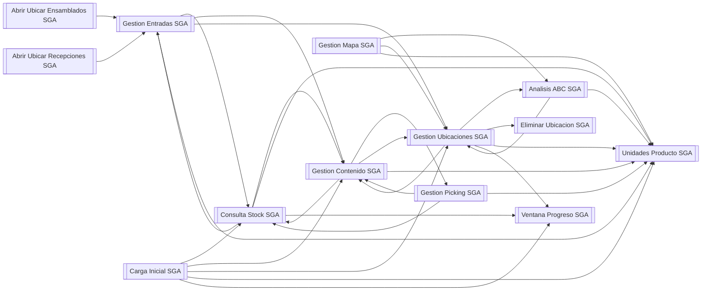
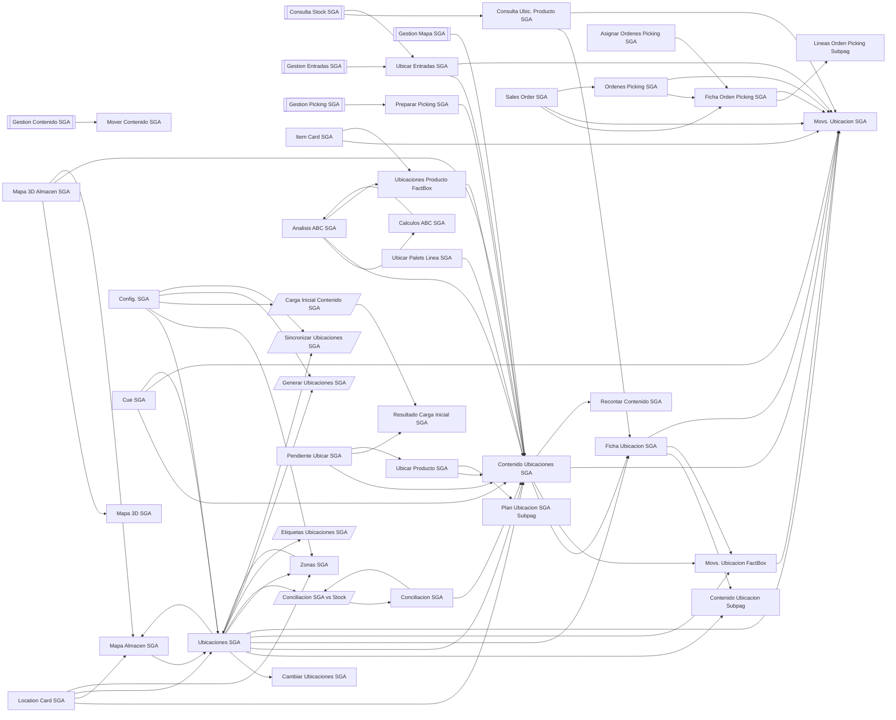

# Mapa de llamadas de SGA

Qué objeto de SGA usa a cuál. Lo genera `GenerarMapaLlamadas.ps1` leyendo el código: no se edita a mano, se vuelve a generar.

Es un mapa de dependencias, no de ejecución: una flecha dice que el objeto nombra al otro (variable, `RunObject`, parte, `SourceTable`...), no cuántas veces ni en qué orden lo llama. No salen los objetos de BC ni los del resto del proyecto, ni los conjuntos de permisos.

Formas: `[[codeunit]]`, `[(tabla)]`, `[/informe/]`, `[página u otro]`.

## Núcleo: codeunits entre sí

Cómo se apoyan los codeunits unos en otros. La puerta de escritura es *Gestion Contenido SGA*; el motor de propuesta, *Gestion Ubicaciones SGA*.

## Quién llama a la lógica

Páginas, informes, extensiones y tablas que usan algún codeunit. La lógica vive en los codeunits; las páginas llaman.

```mermaid
flowchart LR
    n28["Item Card SGA"]
    n5[["Consulta Stock SGA"]]
    n29["Item List SGA"]
    n31["Order Processor SGA"]
    n1[["Abrir Ubicar Ensamblados SGA"]]
    n2[["Abrir Ubicar Recepciones SGA"]]
    n32["Sales Order List SGA"]
    n10[["Gestion Picking SGA"]]
    n33["Sales Order SGA"]
    n36["Analisis ABC SGA"]
    n3[["Analisis ABC SGA"]]
    n37["Asignar Ordenes Picking SGA"]
    n39["Cambiar Ubicaciones SGA"]
    n11[["Gestion Ubicaciones SGA"]]
    n40["Conciliacion SGA"]
    n43["Contenido Ubicaciones SGA"]
    n7[["Gestion Contenido SGA"]]
    n44["Contenido Ubicacion Subpag"]
    n46["Ficha Orden Picking SGA"]
    n47["Ficha Ubicacion SGA"]
    n48["Lineas Orden Picking Subpag"]
    n49["Mapa 3D Almacen SGA"]
    n9[["Gestion Mapa SGA"]]
    n50["Mapa Almacen SGA"]
    n51["Mover Contenido SGA"]
    n54["Ordenes Picking SGA"]
    n55["Pendiente Ubicar SGA"]
    n4[["Carga Inicial SGA"]]
    n8[["Gestion Entradas SGA"]]
    n57["Preparar Picking SGA"]
    n60["Rol Center Almacen SGA"]
    n62["Ubicaciones SGA"]
    n63["Ubicar Entradas SGA"]
    n64["Ubicar Palets Linea SGA"]
    n65["Ubicar Producto SGA"]
    n12[["Unidades Producto SGA"]]
    n70[/"Carga Inicial Contenido SGA"/]
    n71[/"Conciliacion SGA vs Stock"/]
    n73[/"Generar Ubicaciones SGA"/]
    n74[/"Inicializar Contenido SGA"/]
    n75[/"Sincronizar Ubicaciones SGA"/]
    n86[("Linea Ubicacion SGA")]
    n88[("Orden Picking SGA")]
    n89[("Ubicacion SGA")]
    n28 --> n5
    n29 --> n5
    n31 --> n1
    n31 --> n2
    n32 --> n10
    n33 --> n10
    n36 --> n3
    n37 --> n10
    n39 --> n11
    n40 --> n5
    n43 --> n7
    n44 --> n7
    n46 --> n10
    n47 --> n7
    n48 --> n10
    n49 --> n7
    n49 --> n9
    n49 --> n11
    n50 --> n9
    n51 --> n11
    n54 --> n10
    n55 --> n4
    n55 --> n5
    n55 --> n8
    n57 --> n10
    n60 --> n1
    n60 --> n2
    n62 --> n11
    n63 --> n8
    n64 --> n8
    n64 --> n11
    n65 --> n5
    n65 --> n11
    n65 --> n12
    n70 --> n4
    n71 --> n5
    n73 --> n11
    n74 --> n7
    n74 --> n11
    n75 --> n7
    n75 --> n11
    n86 --> n11
    n88 --> n10
    n89 --> n12
```

## Navegación entre pantallas

Qué página, informe o extensión abre o incrusta a cuál (partes, fichas, informes). Los dos menús, *Rol Center Almacen SGA* y *Order Processor SGA*, abren casi todo y no salen aquí: su lista está en la tabla.

## Tabla completa

| Objeto | Tipo | Usa | Lo usan |
|---|---|---|---|
| **Abrir Ubicar Ensamblados SGA** | Codeunit | Gestion Entradas SGA | Order Processor SGA, Rol Center Almacen SGA |
| **Abrir Ubicar Recepciones SGA** | Codeunit | Gestion Entradas SGA | Order Processor SGA, Rol Center Almacen SGA |
| **Analisis ABC SGA** | Codeunit | Calculo ABC SGA, Clasificacion ABC SGA, Config. SGA (tabla), Contenido Ubicacion SGA, Gestion Ubicaciones SGA, Ubicacion SGA, Unidades Producto SGA | Analisis ABC SGA (página), Gestion Mapa SGA, Gestion Ubicaciones SGA |
| **Carga Inicial SGA** | Codeunit | Buffer Conciliacion SGA, Config. SGA (tabla), Consulta Stock SGA, Contenido Ubicacion SGA, Gestion Contenido SGA, Gestion Ubicaciones SGA, Linea Ubicacion SGA, Unidades Producto SGA, Ventana Progreso SGA | Carga Inicial Contenido SGA, Pendiente Ubicar SGA |
| **Consulta Stock SGA** | Codeunit | Buffer Conciliacion SGA, Config. SGA (tabla), Consulta Ubic. Producto SGA, Contenido Ubicacion SGA, Gestion Contenido SGA, Gestion Entradas SGA, Linea Ubicacion SGA, Origen Mov. SGA, Ubicar Entradas SGA, Unidades Producto SGA, Ventana Progreso SGA | Carga Inicial SGA, Conciliacion SGA, Conciliacion SGA vs Stock, Gestion Contenido SGA, Gestion Entradas SGA, Gestion Picking SGA, Item Card SGA, Item List SGA, Pendiente Ubicar SGA, Ubicar Producto SGA |
| **Eliminar Ubicacion SGA** | Codeunit | Ubicacion SGA | Gestion Ubicaciones SGA |
| **Gestion Contenido SGA** | Codeunit | Config. SGA (tabla), Consulta Stock SGA, Contenido Ubicacion SGA, Gestion Picking SGA, Gestion Ubicaciones SGA, Mover Contenido SGA, Movimiento Ubicacion SGA, Origen Mov. SGA, Tipo Mov. Ubicacion SGA, Ubicacion SGA, Unidades Producto SGA | Carga Inicial SGA, Consulta Stock SGA, Contenido Ubicacion Subpag, Contenido Ubicaciones SGA, Ficha Ubicacion SGA, Gestion Entradas SGA, Gestion Picking SGA, Gestion Ubicaciones SGA, Inicializar Contenido SGA, Mapa 3D Almacen SGA, Sincronizar Ubicaciones SGA |
| **Gestion Entradas SGA** | Codeunit | Config. SGA (tabla), Consulta Stock SGA, Contenido Ubicacion SGA, Estrategia Ubicacion SGA, Gestion Contenido SGA, Gestion Ubicaciones SGA, Linea Ubicacion SGA, Movimiento Ubicacion SGA, Origen Mov. SGA, Ubicar Entradas SGA, Unidades Producto SGA | Abrir Ubicar Ensamblados SGA, Abrir Ubicar Recepciones SGA, Consulta Stock SGA, Pendiente Ubicar SGA, Ubicar Entradas SGA, Ubicar Palets Linea SGA |
| **Gestion Mapa SGA** | Codeunit | Analisis ABC SGA (codeunit), Buffer Mapa SGA, Contenido Ubicacion SGA, Contenido Ubicaciones SGA, Gestion Ubicaciones SGA, Ubicacion SGA, Unidades Producto SGA | Mapa 3D Almacen SGA, Mapa Almacen SGA |
| **Gestion Picking SGA** | Codeunit | Config. SGA (tabla), Consulta Stock SGA, Contenido Ubicacion SGA, Estado Preparacion SGA, Estrategia Picking SGA, Gestion Contenido SGA, Linea Orden Picking SGA, Orden Picking SGA, Preparar Picking SGA, Ubicacion SGA, Unidades Producto SGA | Asignar Ordenes Picking SGA, Ficha Orden Picking SGA, Gestion Contenido SGA, Lineas Orden Picking Subpag, Orden Picking SGA, Ordenes Picking SGA, Preparar Picking SGA, Sales Order List SGA, Sales Order SGA |
| **Gestion Ubicaciones SGA** | Codeunit | Analisis ABC SGA (codeunit), Config. SGA (tabla), Contenido Ubicacion SGA, Eliminar Ubicacion SGA, Estado Ubicacion SGA, Estrategia Ubicacion SGA, Gestion Contenido SGA, Linea Ubicacion SGA, Tipo Ubicacion SGA, Tipo UM SGA, Ubicacion SGA, Unidades Producto SGA, Ventana Progreso SGA | Analisis ABC SGA (codeunit), Cambiar Ubicaciones SGA, Carga Inicial SGA, Generar Ubicaciones SGA, Gestion Contenido SGA, Gestion Entradas SGA, Gestion Mapa SGA, Inicializar Contenido SGA, Linea Ubicacion SGA, Mapa 3D Almacen SGA, Mover Contenido SGA, Sincronizar Ubicaciones SGA, Ubicaciones SGA, Ubicar Palets Linea SGA, Ubicar Producto SGA |
| **Unidades Producto SGA** | Codeunit | Config. SGA (tabla), Linea Ubicacion SGA, Tipo UM SGA | Analisis ABC SGA (codeunit), Carga Inicial SGA, Consulta Stock SGA, Gestion Contenido SGA, Gestion Entradas SGA, Gestion Mapa SGA, Gestion Picking SGA, Gestion Ubicaciones SGA, Ubicacion SGA, Ubicar Producto SGA |
| **Ventana Progreso SGA** | Codeunit | — | Carga Inicial SGA, Consulta Stock SGA, Gestion Ubicaciones SGA |
| **Mapa 3D SGA** | Control add-in | — | Mapa 3D Almacen SGA |
| **Clase ABC SGA** | Enum | — | Clasificacion ABC SGA |
| **Control Capacidad SGA** | Enum | — | Config. SGA (tabla) |
| **Control Capacidad Ubic. SGA** | Enum | — | Cambiar Ubicaciones SGA, Ubicacion SGA |
| **Estado Linea Picking SGA** | Enum | — | Linea Orden Picking SGA |
| **Estado Orden SGA** | Enum | — | Orden Picking SGA |
| **Estado Preparacion SGA** | Enum | — | Gestion Picking SGA, Sales Order List SGA, Sales Order SGA |
| **Estado Ubicacion SGA** | Enum | — | Gestion Ubicaciones SGA, Ubicacion SGA |
| **Estrategia Picking SGA** | Enum | — | Config. SGA (tabla), Gestion Picking SGA |
| **Estrategia Ubicacion SGA** | Enum | — | Config. SGA (tabla), Gestion Entradas SGA, Gestion Ubicaciones SGA |
| **Origen Mov. SGA** | Enum | — | Consulta Stock SGA, Gestion Contenido SGA, Gestion Entradas SGA, Linea Ubicacion SGA, Movimiento Ubicacion SGA, Orden Picking SGA, Ubicar Entradas SGA |
| **Tipo Mov. Ubicacion SGA** | Enum | — | Gestion Contenido SGA, Movimiento Ubicacion SGA |
| **Tipo Ubicacion SGA** | Enum | — | Cambiar Ubicaciones SGA, Contenido Ubicacion SGA, Generar Ubicaciones SGA, Gestion Ubicaciones SGA, Ubicacion SGA, Zona SGA |
| **Tipo UM SGA** | Enum | — | Cambiar Ubicaciones SGA, Config. SGA (tabla), Gestion Ubicaciones SGA, Ubicacion SGA, Unidades Producto SGA |
| **Analisis ABC SGA** | Página | Analisis ABC SGA (codeunit), Calculo ABC SGA, Calculos ABC SGA, Clasificacion ABC SGA, Config. SGA (tabla), Contenido Ubicacion SGA, Contenido Ubicaciones SGA, Ubicaciones Producto FactBox | Calculos ABC SGA, Order Processor SGA, Rol Center Almacen SGA |
| **Asignar Ordenes Picking SGA** | Página | Ficha Orden Picking SGA, Gestion Picking SGA, Orden Picking SGA | Order Processor SGA, Rol Center Almacen SGA |
| **Calculos ABC SGA** | Página | Analisis ABC SGA (página), Calculo ABC SGA | Analisis ABC SGA (página), Calculo ABC SGA |
| **Cambiar Ubicaciones SGA** | Página | Control Capacidad Ubic. SGA, Gestion Ubicaciones SGA, Tipo Ubicacion SGA, Tipo UM SGA, Ubicacion SGA, Zona SGA | Ubicaciones SGA |
| **Conciliacion SGA** | Página | Buffer Conciliacion SGA, Conciliacion SGA vs Stock, Consulta Stock SGA, Contenido Ubicaciones SGA | Conciliacion SGA vs Stock, Order Processor SGA, Rol Center Almacen SGA |
| **Config. SGA** | Página | Carga Inicial Contenido SGA, Config. SGA (tabla), Generar Ubicaciones SGA, Sincronizar Ubicaciones SGA, Ubicaciones SGA, Zonas SGA | Order Processor SGA, Rol Center Almacen SGA |
| **Consulta Ubic. Producto SGA** | Página | Config. SGA (tabla), Contenido Ubicacion SGA, Ficha Ubicacion SGA, Movs. Ubicacion SGA | Consulta Stock SGA, Order Processor SGA, Rol Center Almacen SGA |
| **Contenido Ubicacion Subpag** | Página | Contenido Ubicacion SGA, Gestion Contenido SGA | Ficha Ubicacion SGA, Ubicaciones SGA |
| **Contenido Ubicaciones SGA** | Página | Contenido Ubicacion SGA, Ficha Ubicacion SGA, Gestion Contenido SGA, Movs. Ubicacion FactBox, Movs. Ubicacion SGA, Recontar Contenido SGA | Analisis ABC SGA (página), Conciliacion SGA, Contenido Ubicacion SGA, Cue SGA (página), Gestion Mapa SGA, Location Card SGA, Mapa 3D Almacen SGA, Order Processor SGA, Pendiente Ubicar SGA, Preparar Picking SGA, Rol Center Almacen SGA, Ubicaciones Producto FactBox, Ubicaciones SGA, Ubicar Entradas SGA, Ubicar Palets Linea SGA, Ubicar Producto SGA |
| **Cue SGA** | Página | Config. SGA (tabla), Contenido Ubicaciones SGA, Cue SGA (tabla), Movs. Ubicacion SGA, Ubicaciones SGA | Rol Center Almacen SGA |
| **Ficha Orden Picking SGA** | Página | Config. SGA (tabla), Gestion Picking SGA, Lineas Orden Picking Subpag, Movs. Ubicacion SGA, Orden Picking SGA | Asignar Ordenes Picking SGA, Ordenes Picking SGA, Sales Order SGA |
| **Ficha Ubicacion SGA** | Página | Contenido Ubicacion Subpag, Gestion Contenido SGA, Movs. Ubicacion FactBox, Movs. Ubicacion SGA, Ubicacion SGA | Consulta Ubic. Producto SGA, Contenido Ubicaciones SGA, Ubicaciones SGA |
| **Lineas Orden Picking Subpag** | Página | Gestion Picking SGA, Linea Orden Picking SGA | Ficha Orden Picking SGA |
| **Mapa 3D Almacen SGA** | Página | Config. SGA (tabla), Contenido Ubicacion SGA, Contenido Ubicaciones SGA, Gestion Contenido SGA, Gestion Mapa SGA, Gestion Ubicaciones SGA, Mapa 3D SGA, Mapa Almacen SGA, Zona SGA | Order Processor SGA, Rol Center Almacen SGA |
| **Mapa Almacen SGA** | Página | Buffer Mapa SGA, Config. SGA (tabla), Gestion Mapa SGA, Ubicaciones SGA | Location Card SGA, Mapa 3D Almacen SGA, Order Processor SGA, Rol Center Almacen SGA, Ubicaciones SGA |
| **Mover Contenido SGA** | Página | Contenido Ubicacion SGA, Gestion Ubicaciones SGA, Ubicacion SGA, Zona SGA | Gestion Contenido SGA |
| **Movs. Ubicacion FactBox** | Página | Movimiento Ubicacion SGA, Movs. Ubicacion SGA | Contenido Ubicaciones SGA, Ficha Ubicacion SGA, Ubicaciones SGA |
| **Movs. Ubicacion SGA** | Página | Movimiento Ubicacion SGA | Consulta Ubic. Producto SGA, Contenido Ubicaciones SGA, Cue SGA (página), Ficha Orden Picking SGA, Ficha Ubicacion SGA, Item Card SGA, Movimiento Ubicacion SGA, Movs. Ubicacion FactBox, Ordenes Picking SGA, Order Processor SGA, Rol Center Almacen SGA, Sales Order SGA, Ubicaciones SGA, Ubicar Entradas SGA |
| **Ordenes Picking SGA** | Página | Config. SGA (tabla), Ficha Orden Picking SGA, Gestion Picking SGA, Movs. Ubicacion SGA, Orden Picking SGA | Orden Picking SGA, Order Processor SGA, Rol Center Almacen SGA, Sales Order SGA |
| **Pendiente Ubicar SGA** | Página | Buffer Conciliacion SGA, Carga Inicial SGA, Config. SGA (tabla), Consulta Stock SGA, Contenido Ubicaciones SGA, Gestion Entradas SGA, Linea Ubicacion SGA, Resultado Carga Inicial SGA, Ubicar Producto SGA | Order Processor SGA, Rol Center Almacen SGA |
| **Plan Ubicacion SGA Subpag** | Página | Linea Ubicacion SGA | Ubicar Producto SGA |
| **Preparar Picking SGA** | Página | Config. SGA (tabla), Contenido Ubicacion SGA, Contenido Ubicaciones SGA, Gestion Picking SGA, Linea Orden Picking SGA, Orden Picking SGA | Gestion Picking SGA |
| **Recontar Contenido SGA** | Página | Contenido Ubicacion SGA | Contenido Ubicaciones SGA |
| **Resultado Carga Inicial SGA** | Página | Linea Ubicacion SGA | Carga Inicial Contenido SGA, Pendiente Ubicar SGA |
| **Rol Center Almacen SGA** | Página | Abrir Ubicar Ensamblados SGA, Abrir Ubicar Recepciones SGA, Analisis ABC SGA (página), Asignar Ordenes Picking SGA, Carga Inicial Contenido SGA, Conciliacion SGA, Conciliacion SGA vs Stock, Config. SGA (página), Consulta Ubic. Producto SGA, Contenido Ubicaciones SGA, Cue SGA (página), Generar Ubicaciones SGA, Inicializar Contenido SGA, Mapa 3D Almacen SGA, Mapa Almacen SGA, Movs. Ubicacion SGA, Ordenes Picking SGA, Pendiente Ubicar SGA, Sincronizar Ubicaciones SGA, Ubicaciones SGA, Ubicar Palets Linea SGA, Ubicar Producto SGA, Zonas SGA | ALMACEN SGA |
| **Ubicaciones Producto FactBox** | Página | Contenido Ubicacion SGA, Contenido Ubicaciones SGA | Analisis ABC SGA (página), Item Card SGA |
| **Ubicaciones SGA** | Página | Cambiar Ubicaciones SGA, Conciliacion SGA vs Stock, Contenido Ubicacion Subpag, Contenido Ubicaciones SGA, Etiquetas Ubicaciones SGA, Ficha Ubicacion SGA, Generar Ubicaciones SGA, Gestion Ubicaciones SGA, Mapa Almacen SGA, Movs. Ubicacion FactBox, Movs. Ubicacion SGA, Sincronizar Ubicaciones SGA, Ubicacion SGA, Zonas SGA | Config. SGA (página), Cue SGA (página), Location Card SGA, Mapa Almacen SGA, Order Processor SGA, Rol Center Almacen SGA, Ubicacion SGA, Zonas SGA |
| **Ubicar Entradas SGA** | Página | Config. SGA (tabla), Contenido Ubicacion SGA, Contenido Ubicaciones SGA, Gestion Entradas SGA, Linea Ubicacion SGA, Movimiento Ubicacion SGA, Movs. Ubicacion SGA, Origen Mov. SGA | Consulta Stock SGA, Gestion Entradas SGA |
| **Ubicar Palets Linea SGA** | Página | Contenido Ubicacion SGA, Contenido Ubicaciones SGA, Gestion Entradas SGA, Gestion Ubicaciones SGA, Linea Ubicacion SGA | Order Processor SGA, Rol Center Almacen SGA |
| **Ubicar Producto SGA** | Página | Config. SGA (tabla), Consulta Stock SGA, Contenido Ubicacion SGA, Contenido Ubicaciones SGA, Gestion Ubicaciones SGA, Linea Ubicacion SGA, Plan Ubicacion SGA Subpag, Unidades Producto SGA | Order Processor SGA, Pendiente Ubicar SGA, Rol Center Almacen SGA |
| **Zonas SGA** | Página | Ubicaciones SGA, Zona SGA | Config. SGA (página), Location Card SGA, Order Processor SGA, Rol Center Almacen SGA, Ubicaciones SGA, Zona SGA |
| **Item Card SGA** | Ext. página | Consulta Stock SGA, Movs. Ubicacion SGA, Ubicaciones Producto FactBox | — |
| **Item List SGA** | Ext. página | Consulta Stock SGA | — |
| **Location Card SGA** | Ext. página | Contenido Ubicaciones SGA, Mapa Almacen SGA, Ubicaciones SGA, Zonas SGA | — |
| **Order Processor SGA** | Ext. página | Abrir Ubicar Ensamblados SGA, Abrir Ubicar Recepciones SGA, Analisis ABC SGA (página), Asignar Ordenes Picking SGA, Carga Inicial Contenido SGA, Conciliacion SGA, Conciliacion SGA vs Stock, Config. SGA (página), Consulta Ubic. Producto SGA, Contenido Ubicaciones SGA, Generar Ubicaciones SGA, Inicializar Contenido SGA, Mapa 3D Almacen SGA, Mapa Almacen SGA, Movs. Ubicacion SGA, Ordenes Picking SGA, Pendiente Ubicar SGA, Sincronizar Ubicaciones SGA, Ubicaciones SGA, Ubicar Palets Linea SGA, Ubicar Producto SGA, Zonas SGA | — |
| **Sales Order List SGA** | Ext. página | Estado Preparacion SGA, Gestion Picking SGA | — |
| **Sales Order SGA** | Ext. página | Estado Preparacion SGA, Ficha Orden Picking SGA, Gestion Picking SGA, Movs. Ubicacion SGA, Orden Picking SGA, Ordenes Picking SGA | — |
| **Sales Order Subform SGA** | Ext. página | — | — |
| **User Setup SGA** | Ext. página | — | — |
| **ALMACEN SGA** | Perfil | Rol Center Almacen SGA | — |
| **Carga Inicial Contenido SGA** | Informe | Carga Inicial SGA, Config. SGA (tabla), Linea Ubicacion SGA, Resultado Carga Inicial SGA | Config. SGA (página), Order Processor SGA, Rol Center Almacen SGA |
| **Conciliacion SGA vs Stock** | Informe | Buffer Conciliacion SGA, Conciliacion SGA, Config. SGA (tabla), Consulta Stock SGA | Conciliacion SGA, Order Processor SGA, Rol Center Almacen SGA, Ubicaciones SGA |
| **Etiquetas Ubicaciones SGA** | Informe | — | Ubicaciones SGA |
| **Generar Ubicaciones SGA** | Informe | Config. SGA (tabla), Gestion Ubicaciones SGA, Tipo Ubicacion SGA, Zona SGA | Config. SGA (página), Order Processor SGA, Rol Center Almacen SGA, Ubicaciones SGA |
| **Inicializar Contenido SGA** | Informe | Config. SGA (tabla), Gestion Contenido SGA, Gestion Ubicaciones SGA | Order Processor SGA, Rol Center Almacen SGA |
| **Sincronizar Ubicaciones SGA** | Informe | Config. SGA (tabla), Gestion Contenido SGA, Gestion Ubicaciones SGA | Config. SGA (página), Order Processor SGA, Rol Center Almacen SGA, Ubicaciones SGA |
| **Buffer Conciliacion SGA** | Tabla | — | Carga Inicial SGA, Conciliacion SGA, Conciliacion SGA vs Stock, Consulta Stock SGA, Pendiente Ubicar SGA |
| **Buffer Mapa SGA** | Tabla | — | Gestion Mapa SGA, Mapa Almacen SGA |
| **Calculo ABC SGA** | Tabla | Calculos ABC SGA, Clasificacion ABC SGA | Analisis ABC SGA (codeunit), Analisis ABC SGA (página), Calculos ABC SGA, Clasificacion ABC SGA |
| **Clasificacion ABC SGA** | Tabla | Calculo ABC SGA, Clase ABC SGA | Analisis ABC SGA (codeunit), Analisis ABC SGA (página), Calculo ABC SGA |
| **Config. SGA** | Tabla | Control Capacidad SGA, Estrategia Picking SGA, Estrategia Ubicacion SGA, Tipo UM SGA, Zona SGA | Analisis ABC SGA (codeunit), Analisis ABC SGA (página), Carga Inicial Contenido SGA, Carga Inicial SGA, Conciliacion SGA vs Stock, Config. SGA (página), Consulta Stock SGA, Consulta Ubic. Producto SGA, Cue SGA (página), Ficha Orden Picking SGA, Generar Ubicaciones SGA, Gestion Contenido SGA, Gestion Entradas SGA, Gestion Picking SGA, Gestion Ubicaciones SGA, Inicializar Contenido SGA, Mapa 3D Almacen SGA, Mapa Almacen SGA, Orden Picking SGA, Ordenes Picking SGA, Pendiente Ubicar SGA, Preparar Picking SGA, Sincronizar Ubicaciones SGA, Ubicacion SGA, Ubicar Entradas SGA, Ubicar Producto SGA, Unidades Producto SGA |
| **Contenido Ubicacion SGA** | Tabla | Contenido Ubicaciones SGA, Tipo Ubicacion SGA | Analisis ABC SGA (codeunit), Analisis ABC SGA (página), Carga Inicial SGA, Consulta Stock SGA, Consulta Ubic. Producto SGA, Contenido Ubicacion Subpag, Contenido Ubicaciones SGA, Gestion Contenido SGA, Gestion Entradas SGA, Gestion Mapa SGA, Gestion Picking SGA, Gestion Ubicaciones SGA, Mapa 3D Almacen SGA, Mover Contenido SGA, Preparar Picking SGA, Recontar Contenido SGA, Ubicacion SGA, Ubicaciones Producto FactBox, Ubicar Entradas SGA, Ubicar Palets Linea SGA, Ubicar Producto SGA |
| **Cue SGA** | Tabla | — | Cue SGA (página) |
| **Linea Orden Picking SGA** | Tabla | Estado Linea Picking SGA, Orden Picking SGA | Gestion Picking SGA, Lineas Orden Picking Subpag, Orden Picking SGA, Preparar Picking SGA |
| **Linea Ubicacion SGA** | Tabla | Gestion Ubicaciones SGA, Origen Mov. SGA | Carga Inicial Contenido SGA, Carga Inicial SGA, Consulta Stock SGA, Gestion Entradas SGA, Gestion Ubicaciones SGA, Pendiente Ubicar SGA, Plan Ubicacion SGA Subpag, Resultado Carga Inicial SGA, Ubicar Entradas SGA, Ubicar Palets Linea SGA, Ubicar Producto SGA, Unidades Producto SGA |
| **Movimiento Ubicacion SGA** | Tabla | Movs. Ubicacion SGA, Origen Mov. SGA, Tipo Mov. Ubicacion SGA | Gestion Contenido SGA, Gestion Entradas SGA, Movs. Ubicacion FactBox, Movs. Ubicacion SGA, Ubicar Entradas SGA |
| **Orden Picking SGA** | Tabla | Config. SGA (tabla), Estado Orden SGA, Gestion Picking SGA, Linea Orden Picking SGA, Ordenes Picking SGA, Origen Mov. SGA | Asignar Ordenes Picking SGA, Ficha Orden Picking SGA, Gestion Picking SGA, Linea Orden Picking SGA, Ordenes Picking SGA, Preparar Picking SGA, Sales Order SGA |
| **Ubicacion SGA** | Tabla | Config. SGA (tabla), Contenido Ubicacion SGA, Control Capacidad Ubic. SGA, Estado Ubicacion SGA, Tipo Ubicacion SGA, Tipo UM SGA, Ubicaciones SGA, Unidades Producto SGA, Zona SGA | Analisis ABC SGA (codeunit), Cambiar Ubicaciones SGA, Eliminar Ubicacion SGA, Ficha Ubicacion SGA, Gestion Contenido SGA, Gestion Mapa SGA, Gestion Picking SGA, Gestion Ubicaciones SGA, Mover Contenido SGA, Ubicaciones SGA, Zona SGA |
| **Zona SGA** | Tabla | Tipo Ubicacion SGA, Ubicacion SGA, Zonas SGA | Cambiar Ubicaciones SGA, Config. SGA (tabla), Generar Ubicaciones SGA, Mapa 3D Almacen SGA, Mover Contenido SGA, Ubicacion SGA, Zonas SGA |
| **Sales Line SGA** | Ext. tabla | — | — |
| **User Setup SGA** | Ext. tabla | — | — |

## Objetos que ningún otro objeto de SGA nombra

No quiere decir que sobren: pueden abrirse desde el buscador, la cola de proyectos o una URL. Es la lista que hay que mirar al buscar código muerto.

Ninguno.

