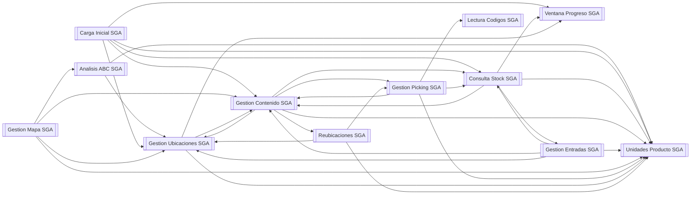

# Mapa de llamadas de SGA

Qué codeunit de SGA llama a cuál. Lo genera `GenerarMapaLlamadas.ps1`: no se edita a mano, se vuelve a generar.

Una flecha `A --> B` significa que el código de A nombra a B; no dice cuántas veces ni en qué orden. Páginas, informes y tablas no salen.

## Codeunits entre sí

La puerta de escritura es *Gestion Contenido SGA*; el motor de propuesta, *Gestion Ubicaciones SGA*.

## Codeunits: qué usan y quién los llama

| Codeunit | Usa | Lo llaman |
|---|---|---|
| **Analisis ABC SGA** | Gestion Ubicaciones SGA, Unidades Producto SGA | Gestion Mapa SGA |
| **Carga Inicial SGA** | Consulta Stock SGA, Gestion Contenido SGA, Gestion Ubicaciones SGA, Unidades Producto SGA, Ventana Progreso SGA | — |
| **Consulta Stock SGA** | Gestion Contenido SGA, Gestion Entradas SGA, Unidades Producto SGA, Ventana Progreso SGA | Carga Inicial SGA, Gestion Contenido SGA, Gestion Entradas SGA, Gestion Picking SGA |
| **Gestion Contenido SGA** | Consulta Stock SGA, Gestion Picking SGA, Gestion Ubicaciones SGA, Reubicaciones SGA, Unidades Producto SGA | Carga Inicial SGA, Consulta Stock SGA, Gestion Entradas SGA, Gestion Mapa SGA, Gestion Picking SGA, Gestion Ubicaciones SGA |
| **Gestion Entradas SGA** | Consulta Stock SGA, Gestion Contenido SGA, Gestion Ubicaciones SGA, Unidades Producto SGA | Consulta Stock SGA |
| **Gestion Mapa SGA** | Analisis ABC SGA, Gestion Contenido SGA, Gestion Ubicaciones SGA, Unidades Producto SGA | — |
| **Gestion Picking SGA** | Consulta Stock SGA, Gestion Contenido SGA, Lectura Codigos SGA, Unidades Producto SGA | Gestion Contenido SGA, Reubicaciones SGA |
| **Gestion Ubicaciones SGA** | Gestion Contenido SGA, Unidades Producto SGA, Ventana Progreso SGA | Analisis ABC SGA, Carga Inicial SGA, Gestion Contenido SGA, Gestion Entradas SGA, Gestion Mapa SGA, Reubicaciones SGA |
| **Lectura Codigos SGA** | — | Gestion Picking SGA |
| **Reubicaciones SGA** | Gestion Picking SGA, Gestion Ubicaciones SGA, Unidades Producto SGA | Gestion Contenido SGA |
| **Unidades Producto SGA** | — | Analisis ABC SGA, Carga Inicial SGA, Consulta Stock SGA, Gestion Contenido SGA, Gestion Entradas SGA, Gestion Mapa SGA, Gestion Picking SGA, Gestion Ubicaciones SGA, Reubicaciones SGA |
| **Ventana Progreso SGA** | — | Carga Inicial SGA, Consulta Stock SGA, Gestion Ubicaciones SGA |

## Codeunits que ningún objeto de SGA nombra

No quiere decir que sobren: pueden ejecutarse desde el buscador, la cola de proyectos o una URL. Es la lista que hay que mirar al buscar código muerto.

Ninguno.

